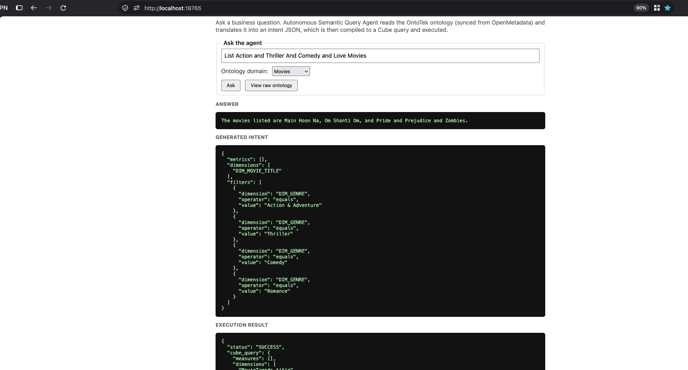
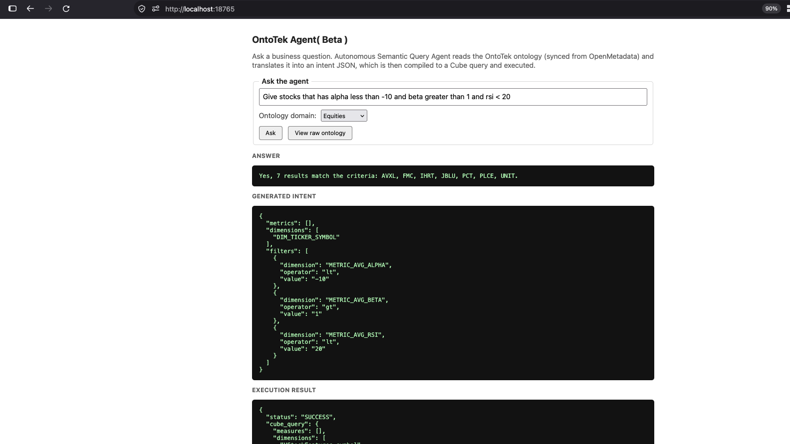

# OntoTek

## What this app is

OntoTek lets someone ask a business question in plain English — "list action
and thriller and love movies", "give stocks where alpha is below -10" — and
get back a real, correct answer, without writing SQL or knowing the schema.
Under the hood an LLM never touches the database directly. It only ever
picks from a fixed, governed vocabulary of metric/dimension ids and their
allowed values (the *ontology*), synced live from
[OpenMetadata](https://open-metadata.org)'s catalog/glossary and from
Postgres's own distinct column values. That constrained choice — the
"intent" — is validated, then compiled into a [Cube](https://cube.dev) query
that Cube executes against Postgres, and the result is turned back into a
short natural-language answer. The payoff: the model can't invent a column,
misspell a category, or write an unsafe query, because it is never free to
say anything outside the governed vocabulary.

A FastMCP server ([app/server.py](app/server.py)) that compiles a bounded, structured
"intent" JSON block (chosen metric/dimension IDs + enum-validated filters)
into a [Cube](https://cube.dev) query and executes it — so an LLM agent
classifies intent against a fixed vocabulary instead of writing SQL itself.
Cube owns join resolution, aggregation, and SQL generation against Postgres
(replacing an earlier hand-rolled SQL-string compiler).

The semantic layer's *vocabulary* — the metric/dimension IDs the tool accepts,
each mapped to a Cube measure/dimension (`cube_measure`/`cube_dimension`) — is
**not a file on disk**. [loader/ontology_loader.py](loader/ontology_loader.py) builds it
live from [OpenMetadata](https://open-metadata.org) (catalog/glossary) +
Postgres (`allowed_values`) every time `server.py` starts, and `server.py`
just holds the result in memory (`ONTOLOGY_CACHE`) for the life of the
process — restart to pick up catalog/glossary changes. There used to be a
generated `ontotek_graph.json` file a separate script regenerated by hand;
it's gone (see "Where the vocabulary actually lives" below).

Cube's own model — one dynamically-generated file,
[loader/cube/model/cubes/dynamic.yml.jinja](loader/cube/model/cubes/dynamic.yml.jinja),
covering all 22 cubes across `ontotek` + `sifttek` + `alpha` (no hand-written
per-table YAML at all anymore) — is the actual query-execution source of
truth; Cube resolves joins and generates SQL from it, and `server.py` never
sees it directly.

## Example: how a question maps onto the ontology

Two live runs of the agent tester, each showing the same pipeline — natural
language -> ontology-constrained intent JSON -> Cube query -> answer — but a
different kind of mapping, depending on the domain.

### Movies: a conceptual mapping



`DIM_GENRE`'s `allowed_values` are `SELECT DISTINCT genre` straight from
Postgres (see "Design note" below) — there is no `"Love"` value in the
database. The question's wording has to be resolved by meaning against the
closed allowed-values list the system prompt hands the model
(`app/ontotek_agent.py`'s `_build_system_prompt`), under a hard
schema constraint that only an allowed value can be emitted:

| Phrase in the question | Resolved filter |
|---|---|
| "Love Movies" | `DIM_GENRE = "Romance"` |
| "Action ... Movies" | `DIM_GENRE = "Action & Adventure"` |
| "Thriller" / "Comedy" | `DIM_GENRE = "Thriller"` / `"Comedy"` (one filter per value, never merged) |

### Equities: a literal + rule-based mapping



Here the metric ids (`METRIC_AVG_ALPHA`/`BETA`/`RSI`) are near-literal matches
for the words in the question — the actual translation work is comparison
*language* into an operator, the same whether the question uses words or
symbols:

| Phrase in the question | Resolved filter |
|---|---|
| "alpha less than -10" | `METRIC_AVG_ALPHA lt "-10"` |
| "beta greater than 1" | `METRIC_AVG_BETA gt "1"` |
| "rsi < 20" | `METRIC_AVG_RSI lt "20"` |
| "stocks" (listing question) | `dimensions: ["DIM_TICKER_SYMBOL"]` |

Both paths run through the same validation/repair loop before a filter ever
reaches Cube: an unresolvable category filter is rejected outright
(`compile_and_execute_intent`), and a metric filter's operator/value pair is
re-derived straight from the question text whenever the model's own output
and the question's comparison-phrase count match 1:1
(`_repair_metric_filters` in `app/ontotek_agent.py`) — a documented safety
net for a small local model's tendency to lose the numeric value once a
question stacks two or more metric filters.

**Why the two domains differ.** Movies needed a conceptual leap: nothing in
the schema says "love" relates to "Romance" — the model supplies that from
its own world knowledge, constrained to pick only from the closed,
DB-sourced allowed-values list rather than inventing a new category.
Equities needed almost no semantic leap at all (the metric names are
close to literal) but stacks three separate numeric comparisons in one
sentence, mixing worded ("less than", "greater than") and symbolic ("<")
forms — which is exactly the shape of question the deterministic
operator-repair net above exists to get right.

## Where the demo data lives

The OntoTek demo tables live in a dedicated `ontotek` schema inside the
existing local `mltek` Postgres database, accessed through a least-privilege
`ontotek_reader` role. `mltek` also holds two unrelated real schemas —
`alpha` (stock ML data) and `beta` (merchant/payments workflow data).
`ontotek_reader` was later also granted read access to `alpha` (at the
user's request, for Cube's alpha-data cubes below); `beta` remains
inaccessible to it. A separate database, `sifttek` (personal-finance app,
different role), was cataloged in OpenMetadata as its own service and is now
also wired into the vocabulary and Cube, through its own least-privilege
`sifttek_reader` role and Cube datasource (see `deploy/db/sifttek_reader.sql` and
`CUBEJS_DS_SIFTTEK_*` in `docker-compose.yml`) — it's a separate physical
Postgres database, not a schema inside `mltek`, so it needs its own
connection on both sides.

## Setup, in order

All of this section's scripts/templates/SQL are one-time (or occasional)
setup — nothing agent request processing touches — and live under
[deploy/](deploy/), separate from the runtime code
(`app/server.py`, `app/ontotek_agent.py`, `app/ontotek_ui.py`), the
OpenMetadata/Cube loader code under [loader/](loader/), and the running
stack's own data (`openmetadata/docker-volume/`). The vocabulary itself
has no local file at all — see "Where the vocabulary actually lives" below.

1. **Demo schema + scoped role** (one-time):
   ```bash
   READER_PW=$(openssl rand -hex 24)
   psql "postgresql://namburi@localhost:5432/mltek" -v reader_password="$READER_PW" -f deploy/db/ontotek_schema.sql
   ```
   Put `$READER_PW` into `.env` as part of `POSTGRES_READ_ONLY_URI` (see `.env.example`).

   Same pattern for the separate `sifttek` database:
   ```bash
   SIFTTEK_READER_PW=$(openssl rand -base64 24)
   psql "postgresql://namburi@localhost:5432/sifttek" -v reader_password="$SIFTTEK_READER_PW" -f deploy/db/sifttek_reader.sql
   ```
   Put `$SIFTTEK_READER_PW` into `.env` as `SIFTTEK_READER_PASSWORD` and as
   part of `SIFTTEK_READ_ONLY_URI` (see `.env.example`) — both Cube's second
   datasource and `loader/ontology_loader.py` (every `server.py` startup) need it.

2. **Bring up the stack** — one [docker-compose.yml](docker-compose.yml) at
   the project root for everything: OpenMetadata (a dedicated Postgres
   container for its own metadata store, Elasticsearch, the OM server, an
   Airflow-based ingestion container; ~4-6GB RAM, a few minutes to start)
   *and* Cube (the query compiler — replaces the old hand-rolled SQL builder
   in `server.py`). It auto-loads `.env` from this same directory, so both
   `ONTOTEK_READER_PASSWORD` and `CUBEJS_API_SECRET` need to be set there
   first (see `.env.example`).

   OpenMetadata's own backend Postgres (`openmetadata_postgresql`
   container, image `docker.getcollate.io/openmetadata/postgresql:2.0.2`)
   is a **separate Postgres server**, unrelated to the native `mltek`/
   `sifttek` instance the rest of this project targets — it holds `openmetadata_db`
   and `airflow_db`, exists only inside the Docker network (no host port
   published, avoiding a `:5432` collision with the native Postgres), and
   is disposable: rebuilding it from scratch just means re-running steps 3-5
   below (all under a minute — nothing here is hand-edited state).
   ```bash
   docker compose up --detach
   curl -sf http://localhost:8585/api/v1/system/version   # OpenMetadata readiness
   curl -sf http://localhost:4000/cubejs-api/v1/meta       # Cube readiness + schema-load check
   ```
   OpenMetadata UI at `http://localhost:8585` (default
   `admin@open-metadata.org` / `admin`), version pinned in
   [loader/openmetadata/VERSION.md](loader/openmetadata/VERSION.md). Cube runs with
   `CUBEJS_DEV_MODE=true` (auth disabled) — see
   [loader/cube/VERSION.md](loader/cube/VERSION.md) before exposing it beyond localhost.
   All 22 cubes — `ontotek` (3 tables), `sifttek` (14 tables, `data_source:
   sifttek` — Cube's second, separately-connected datasource), and `alpha`
   (5 real stock tables, same default datasource as `ontotek` since both
   live in the `mltek` Postgres database) — are **dynamically generated at
   Cube's own startup**, live from OpenMetadata — see
   [loader/cube/model/globals.py](loader/cube/model/globals.py) for how and why (same
   "don't hand-maintain a file per table" reasoning as `loader/ontology_loader.py`,
   applied to Cube's own model instead of the vocabulary). Only `ontotek`'s
   and `sifttek`'s cubes are wired into `compile_and_execute_intent`'s
   metric/dimension IDs; `alpha`'s are queryable directly via Cube's API but
   not yet part of the agent's vocabulary. `sql_table`, dimensions
   (including synthesizing a `CONCAT(...)` key for tables with a composite
   or no single-column primary key, e.g. `daily_decisions`/`stock_hist`),
   and straightforward FK joins are auto-derived from column metadata;
   business-specific measures, non-FK joins, and excluded columns
   (`items.encrypted_access_token`/`transactions_cursor` — a credential and a
   sync cursor, not semantic data, also excluded from `sifttek_reader`'s
   grants at the DB level) are hand-curated in
   [loader/cube/model/cube_overlays.json](loader/cube/model/cube_overlays.json).

   Get the ingestion-bot's JWT (used by all the tooling below) and put it in
   `.env` as `OPENMETADATA_JWT_TOKEN`:
   ```bash
   ADMIN_TOKEN=$(curl -s -X POST http://localhost:8585/api/v1/users/login \
     -H "Content-Type: application/json" \
     -d '{"email":"admin@open-metadata.org","password":"YWRtaW4="}' \
     | python3 -c "import json,sys;print(json.load(sys.stdin)['accessToken'])")
   USER_ID=$(curl -s "http://localhost:8585/api/v1/users/name/ingestion-bot" \
     -H "Authorization: Bearer $ADMIN_TOKEN" | python3 -c "import json,sys;print(json.load(sys.stdin)['id'])")
   curl -s "http://localhost:8585/api/v1/users/auth-mechanism/$USER_ID" \
     -H "Authorization: Bearer $ADMIN_TOKEN" | python3 -c "import json,sys;print(json.load(sys.stdin)['config']['JWTToken'])"
   ```

3. **Ingest the `ontotek` schema**, scoped so `alpha`/`beta`/`public` are
   never touched. Runs inside the `ingestion` container (it already ships
   the `metadata` CLI + Postgres connector — no separate venv needed; a
   host venv was tried first but skipped since only Python 3.14 was
   available locally and the ingestion framework's compatibility with it
   wasn't verified):
   ```bash
   set -a; source .env; set +a
   ./loader/openmetadata/render_ingestion_yaml.sh
   docker compose cp loader/openmetadata/postgres_ingestion.rendered.yaml ingestion:/tmp/postgres_ingestion.yaml
   docker compose exec ingestion metadata ingest -c /tmp/postgres_ingestion.yaml
   ```
   (Same pattern for `loader/openmetadata/alpha_ingestion.yaml.tmpl` and
   `loader/openmetadata/sifttek_ingestion.yaml.tmpl` via their own render
   scripts — `sifttek`'s ingestion is required, not optional, since
   `server.py`'s live ontology build reads its catalog on every startup.)
   Verify in the UI: Explore → Databases → `mltek_ontotek` → `mltek` → `ontotek`
   shows exactly 3 tables, with a FK constraint from `movietek_sales` to
   `movietek_catalog`.

4. **Tag the vocabulary** — there's no seed file to run; each DIM_*/METRIC_*
   is a glossary term + a tag on its column (+ an `ontotekAggregation`
   custom property for metrics), authored directly in OpenMetadata. Use the
   CLI helper rather than clicking through the UI:
   ```bash
   source .venv-tools/bin/activate   # python3 -m venv .venv-tools && pip install -r loader/requirements.txt
   python loader/openmetadata/tag_vocabulary.py \
       --table v_stock_features --column wave \
       --term DIM_WAVE --name "wave pattern" --synonyms wave,elliott-wave
   ```
   `server.py`'s next startup reads it live — see "Where the vocabulary
   actually lives" below for the full mechanism.

5. **Run the server** (Cube is already up from step 2):
   ```bash
   pip install -r requirements.txt
   python app/server.py
   ```
   Every startup fetches fresh: the vocabulary's ~10 anchored tables from
   OpenMetadata, glossary terms, and `allowed_values` from Postgres — see
   `loader/ontology_loader.py`'s module docstring for exactly what's fetched and why
   it stays cheap even at catalog sizes far bigger than this demo's.

## Launching the UIs

Three UIs, once the stack is up (step 2) and the server's running (step 5):

| UI | URL | Login | What it's for |
|---|---|---|---|
| OpenMetadata | http://localhost:8585 | `admin@open-metadata.org` / `admin` | Browse the catalog (Explore → Databases), the `OntoTekSemantics` glossary, lineage. `loader/ontology_loader.py` reads this live on every `server.py` startup. |
| Cube Playground | http://localhost:4000 | none (dev mode, auth disabled) | Build/run queries against all 22 cubes directly — measures, dimensions, generated SQL, and the security-context/data-source picker. Useful for checking a cube in isolation, outside the agent's fixed vocabulary. All of them (`ontotek`/`sifttek`/`alpha`) are dynamically generated at Cube's own startup — see `loader/cube/model/globals.py`. |
| OntoTek agent tester | http://localhost:8765 | none (local only) | `python3 app/ontotek_ui.py` — ask a question in plain English and see the local LLM's generated intent JSON plus the Cube result, or switch to "Manual / advanced mode" to hand-build an intent JSON directly against `compile_and_execute_intent` (e.g. to test the enum-rejection path with an invalid filter value). Needs Ollama running locally with `qwen2.5-coder:3b` pulled (`ollama pull qwen2.5-coder:3b`) — see `app/ontotek_agent.py` for why that model, not `qwen2.5-coder:3b`, is used here. |

```bash
# after `docker compose up --detach` (step 2) and installing requirements.txt:
python3 app/ontotek_ui.py
# -> OntoTek test UI running at http://localhost:8765
```

The MCP server itself (`app/server.py`, step 5) has no UI of its own — it's
stdio-based, meant to be driven by an MCP client (Claude Desktop/Code) or,
for manual testing, by `app/ontotek_ui.py` above.

## Where the vocabulary actually lives

Earlier versions of this project cached the vocabulary in a generated
`ontotek_graph.json` file, then in a set of hand-maintained local files
(`DIMENSION_ANCHORS` in `loader/ontology_loader.py`, `metric_overrides.json`,
`dimension_metadata.json`, plus a duplicate copy of the anchor mappings in
`seed_glossary.py` used only for tagging). All of that had the same failure
mode: nothing enforced the copies agreed with each other, and drift between
them caused real bugs (a stale table reference breaking Cube compilation; a
dimension's `allowed_values` type mismatching what the filter-validation
code expected).

There is now **no local vocabulary file at all**. A column becomes part of
the vocabulary by being tagged, directly in OpenMetadata, with a glossary
term under the `OntoTekSemantics` glossary — `DIM_*` for a category
dimension, `METRIC_*` for a metric (which also needs an `ontotekAggregation`
custom property on that same column, set to `avg` or `countDistinct`). Use
`loader/openmetadata/tag_vocabulary.py` to do this (step 4 above) rather than
clicking through the UI.

At every `server.py` startup, `loader/ontology_loader.py` runs one bounded
OpenMetadata search query (`tags.tagFQN:OntoTekSemantics.*`) that returns
every tagged table+column in a single call — cost is O(number of tagged
columns), never O(total tables in the catalog), same property the old
hand-maintained files gave, without either needing to exist. `loader/cube/model/globals.py`
does the equivalent on Cube's side, auto-generating each metric's Cube
measure from the same tags + custom property. Both derive a metric's exact
Cube measure name the same mechanical way (aggregation + PascalCase(column),
e.g. `avgRsi`, `countDistinctSymbol`) — they have to agree, since
`server.py` sends the name `ontology_loader.py` computed straight into a
Cube query.

What's still hand-authored, necessarily — the actual *decision* of which
columns belong in the vocabulary, their display name/synonyms, and (for
metrics) which aggregation makes sense — now lives as data *in OpenMetadata
itself* (glossary terms + tags + the custom property), not as a second copy
in this repo. `loader/cube/model/cube_overlays.json` still holds what's
genuinely not derivable from a (column, aggregation) pair — non-FK joins,
excluded columns, and (space is there for it, unused today) a multi-column
or conditional metric formula that doesn't fit that shape.

## Design note: why `allowed_values` bypasses OpenMetadata's profiler

`loader/ontology_loader.py` queries Postgres directly (`SELECT DISTINCT ...`) for
dimension enum values instead of using OpenMetadata's data-profiler API. This
is deliberate: the profiler API's current shape wasn't verified against this
OpenMetadata release, while querying the already-trusted `ontotek_reader`/
`sifttek_reader` read-only connections is simpler and just as correct at this
demo's scale.
